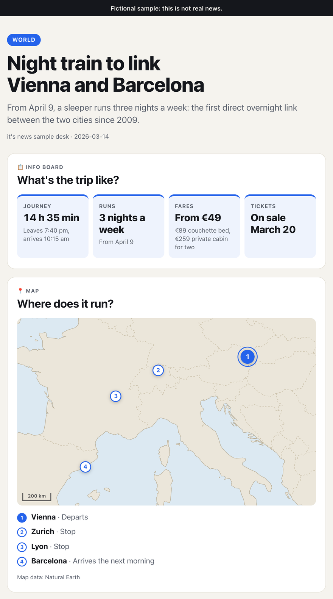
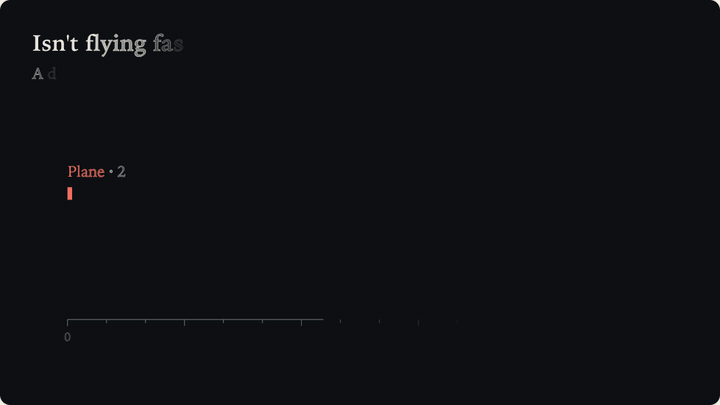
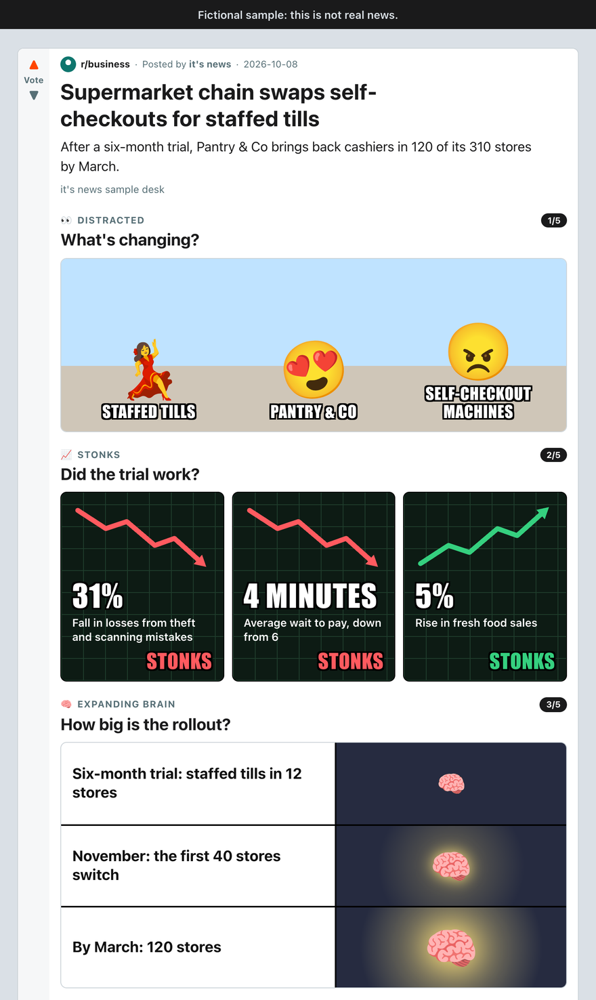

# it's news

**News you get in seconds, not minutes.**

There's more than one way to make news quick to take in, so it's news tries
several, side by side. Each approach lives in its own folder, with its own
README, setup and tests. The pictures below come from fictional sample
articles.

### Template rendering: the whole story on one page

An AI agent reads the article, works out the questions a reader would ask, and
answers each with the template that answers it fastest.

<p align="center">
  
</p>
<p align="center"><sub>An info board and a map for the night train story.</sub></p>

[Example page](template-rendering/examples/night-train.html) ·
[example edition](template-rendering/examples/edition.html) ·
[how it works](template-rendering/)

### Animated explainer: one idea per click

*Prototype.* The story plays as a few pages of vector animation, five by
default, and each click builds one more thing on screen.

<p align="center">
  
</p>
<p align="center"><sub><i>Isn't flying faster?</i> The explainer answers with the article's own numbers.</sub></p>

[Example explainer](animated-explainer/examples/night-train.html) ·
[design and plans](animated-explainer/)

### Meme rendering: news for the scroll

Each story is a post, told in meme formats readers already know. The memes are redrawn in HTML, CSS and emoji, so a page carries no one
else's images.

<p align="center">
  
</p>
<p align="center"><sub>Distracted, stonks and expanding brain for a supermarket story.</sub></p>

[Example post](meme-rendering/examples/self-checkout.html) ·
[a serious story](meme-rendering/examples/river-flood.html) ·
[example feed](meme-rendering/examples/edition.html) ·
[how it works](meme-rendering/)

## Playful, never made up

The AI agent makes the editorial calls. Plain code keeps it honest.

```
 article.md ──► AI agent ──► storyboard.json ──► check ──► render ──► page.html
                  ▲                                │
                  └────── fix what check reports ◄─┘
```

- **Every number and quote** on the page must come from the article, quotes
  word for word. The check rejects anything else, and the agent fixes its
  storyboard until the check passes.
- **Word budgets** keep each caption short, so a page never turns back into a
  wall of text.
- **One file, no network.** Each page is a single self-contained HTML file,
  in light and dark themes, that loads nothing from the network.
- **Any language.** The page's own words, such as labels and credits, can be
  replaced with a labels file.

Template rendering and meme rendering share this checking and rendering code,
in [common/](common/). The animated explainer is meant to follow the same rules
once it has a pipeline.

## Try it

The quickest look: clone the repo and open any `.html` file in an `examples/`
folder in your browser. Each one is a single file.

To render pages yourself (Python 3.10 or newer):

```bash
git clone https://github.com/wh1temustang/it-s-news.git
cd it-s-news/template-rendering
python3 -m venv .venv && .venv/bin/pip install -e ../common -e .
.venv/bin/python -m template_rendering gallery   # every template on one page
open output/gallery.html
```

Meme rendering works the same way, with `meme_rendering`. To present your own
article, see the approach's README, or ask a coding agent working in this repo
to "present this article".

## Today's news, every morning

[daily-edition/](daily-edition/) is an Agent Skill that does the whole morning
run. An AI agent finds today's news, writes each story up from its sources and
renders them as one page with an approach. From a clone, in Claude Code:

```bash
claude "Make an it's news edition about tech and climate, 4 stories."
```

Claude publishes the page as an artifact, on a schedule if you like; Muse Code
and other agents write it to a file. The folder explains how to run it and how
to share the skill.

## Add your own approach

Got another way to make news quick to take in? Give it its own folder next to
the others, reuse [common/](common/) for reading articles and checking facts,
and follow "Adding an approach" in [AGENTS.md](AGENTS.md#adding-an-approach).

## Open source: no credentials, no private data

it's news is an open-source project. Everything committed here is public, and
git history keeps it public even after a file is deleted. **Never commit
credentials or anything that could violate someone's privacy**, including:

- API keys, access tokens, passwords, session cookies, private keys and
  certificates
- `.env` files or local config that holds secrets. Read secrets from
  environment variables, and if a config template helps, commit a
  `.env.example` with placeholder values only.
- Personal data: names, emails, phone numbers, addresses or anything else
  that identifies a private person, such as user data or reader feedback
- Your own private details, such as a work email in git commit metadata.
  GitHub's `noreply` commit email keeps your address out of the history.

If a secret is committed by accident, **revoke or rotate it right away**.
Rewriting history does not undo the leak, because clones and forks may
already have it.

## Languages

- **Human language:** English. It's the primary language for the news
  content, code, comments, docs, issues and pull requests.
- **Programming languages:** Python and Rust.

## License

MIT. See [LICENSE](LICENSE). The map data in template rendering comes from
[Natural Earth](https://www.naturalearthdata.com/) and is in the public domain.
The emoji in the screenshots are [Noto Color Emoji](https://github.com/googlefonts/noto-emoji)
(Apache 2.0).
