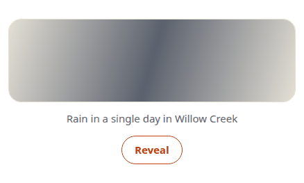

# it's news

**News you get in seconds, not minutes.**

The easiest way to try it: paste this link into Muse and ask it for a daily
news brief — it will find today's news and render it as a visual page.

https://github.com/wh1temustang/it-s-news

It turns the day's news into a visual, single-file page. No setup needed —
or clone the repo and open any `.html` file in an `examples/` folder.

## Three ways to read the news

- **Template rendering** — the whole story on one page: info boards, maps,
  charts, timelines. [Example](template-rendering/examples/night-train.html) ·
  [how it works](template-rendering/)
- **Animated explainer** *(prototype)* — one idea per click, a few pages of
  vector animation. [Example](animated-explainer/examples/night-train.html) ·
  [design](animated-explainer/)
- **Meme rendering** — the story as a post, in meme formats readers already
  know. [Example](meme-rendering/examples/self-checkout.html) ·
  [how it works](meme-rendering/)

They mix and match: an edition is templates by default, one deep story may
carry an animated explainer, and a number worth feeling may get a reactive
scene — scratch to reveal it, wipe from before to after, or press and hold
to fill it up. [Reactive example](template-rendering/examples/reactive-rain.html) ·
[mixed example edition](template-rendering/examples/edition.html)

<p align="center">
  
</p>
<p align="center"><sub>Scratch, wipe and hold for the Willow Creek rain story.</sub></p>

## Playful, never made up

- **Every number and quote** must come from the article. The check rejects
  anything else, and the agent fixes its storyboard until it passes.
- **One file, no network.** Each page is a single self-contained HTML file,
  in light and dark themes.
- **Any language.** The page's own words, such as labels and credits, can be
  replaced with a labels file.

## Render it yourself

```bash
git clone https://github.com/wh1temustang/it-s-news.git
cd it-s-news/template-rendering
python3 -m venv .venv && .venv/bin/pip install -e ../common -e .
.venv/bin/python -m template_rendering gallery   # every template on one page
```

See each approach's README for details, or ask a coding agent working in
this repo to "present this article". The
[daily-edition](daily-edition/) skill renders a whole morning edition from
your newsletters.

Everything here is public — never commit credentials or personal data. Got
another way to make news quick to take in? Add an approach, following
[AGENTS.md](AGENTS.md#adding-an-approach).

## License

MIT. See [LICENSE](LICENSE).
