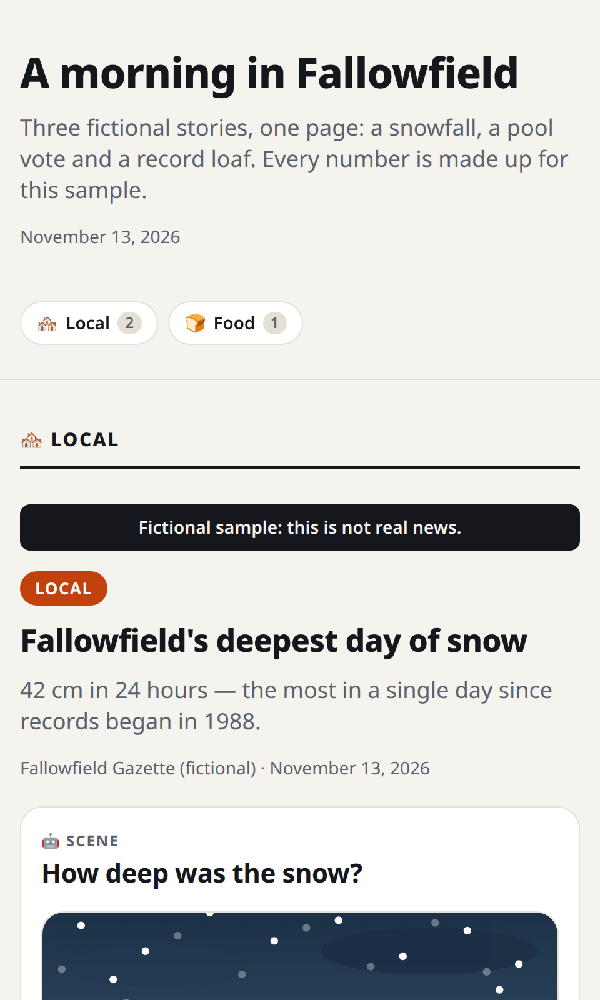
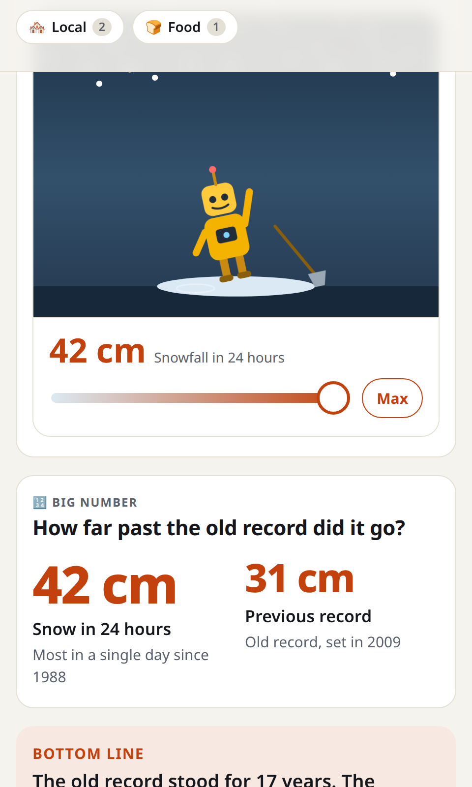
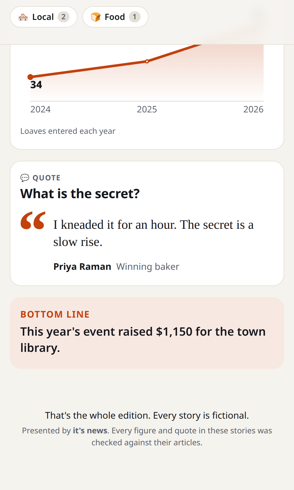

# it's news

**News that's fun to read.**

The easiest way to try it: paste this link into Muse and ask it for a daily
news brief — it will find today's news and render it as a visual page.

https://github.com/wh1temustang/it-s-news

It turns the day's news into a visual, single-file page. No setup needed —
or clone the repo and open any `.html` file in an `examples/` folder.

<p align="center">
  
  
  
</p>
<p align="center"><sub>A fictional English edition — <a href="template-rendering/examples/english-edition.html">read the whole page</a>.</sub></p>

## Templates

| Template | What it answers | Example |
|---|---|---|
| `scene` | The robot pictures the beat | [Wrenfield rain](template-rendering/examples/scene-rain.html) |
| `info-board` | The essentials at a glance | [Night train](template-rendering/examples/night-train.html) |
| `big-number` | One number is the news | [Bike lanes](template-rendering/examples/bike-lanes.html) |
| `timeline` | How did we get here? | [Night train](template-rendering/examples/night-train.html) |
| `map` | Where does it happen? | [Night train](template-rendering/examples/night-train.html) |
| `bar-chart` | How do values compare? | [Bike lanes](template-rendering/examples/bike-lanes.html) |
| `line-chart` | How has it changed over time? | [Bike lanes](template-rendering/examples/bike-lanes.html) |
| `comparison` | How do two sides differ? | [Night train](template-rendering/examples/night-train.html) |
| `cause-effect` | Why is it happening? | No example yet — see the [kit README](template-rendering/README.md) |
| `quote` | What did someone say? | [Bike lanes](template-rendering/examples/bike-lanes.html) |
| `reactive` | What does it feel like to touch? | [Reactive rain](template-rendering/examples/reactive-rain.html) |

An edition is templates by default. One deep story may also carry an
[animated explainer](animated-explainer/examples/night-train.html), and
[meme rendering](meme-rendering/) tells a story as a post.

## Playful, never made up

- **Every number and quote** must come from the article. The check rejects
  anything else, and the agent fixes its storyboard until it passes.
- **One file, no network.** Each page is a single self-contained HTML file,
  in light and dark themes.
- **Any language.** The words the page adds itself — headings, labels,
  credits — live in a labels file. Swap it for another language's file and
  the same story renders in that language.

## Render it yourself

```bash
git clone https://github.com/wh1temustang/it-s-news.git
cd it-s-news/template-rendering
python3 -m venv .venv && .venv/bin/pip install -e ../common -e .
.venv/bin/python -m template_rendering gallery   # every template on one page
```

See each approach's README for details, or ask a coding agent working in
this repo to "present this article". The
[daily-edition](daily-edition/) skill renders a whole morning edition from
your newsletters.

Everything here is public — never commit credentials or personal data. Got
another way to make news quick to take in? Add an approach, following
[AGENTS.md](AGENTS.md#adding-an-approach).

## License

MIT. See [LICENSE](LICENSE).
